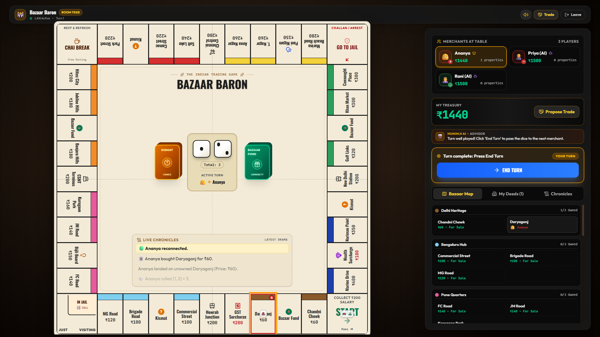

# 🕌 Bazaar Baron — LAN Tabletop Board Game

[](https://nodejs.org/)
[](https://react.dev/)
[](https://socket.io/)
[](https://tailwindcss.com/)
[](https://nodejs.org/api/test.html)
[]()

**Bazaar Baron** is a rich, Monopoly-style multiplayer property trading board game engineered for 2–6 players across a Local Area Network (LAN / Wi-Fi). One host machine runs a unified Node.js server; all other players connect seamlessly from any mobile phone, tablet, or PC browser on the same Wi-Fi. 

Zero internet connection needed. No accounts, no ads, no trackers — pure tabletop camaraderie.

---

## 📸 Visual Showcase

<div align="center">

### Desktop Board Experience (1080p & 4K)
*Authentic quad-fold cardboard tabletop board with rotating perimeter tiles, 3D dice, and full territory overview.*



<br/>

### Mobile Portrait & Laptop Views
*Playable on any phone in portrait mode with touch-friendly 44px+ tap targets, collapsible bottom sheets, and responsive side panel.*

| 📱 Mobile Phone (390×844) | 💻 Laptop Screen (1366×768) |
| :---: | :---: |
|  |  |

</div>

---

## ⚡ 1-Click Launch (Windows)

Simply double-click the included **`start.bat`** file in the root directory:

```bat
start.bat
```

`start.bat` will automatically:
1. Verify Node.js v20+ is installed.
2. Automatically install server & client dependencies if missing (`npm install`).
3. Build the production client bundle (`npm run build`).
4. Start the server on `http://localhost:3000` and open your default browser.
5. Display your local Wi-Fi IP and a scannable QR code directly in the terminal so your friends can scan and join from their phones!

---

## ✨ Highlights & Key Features

- **Classic Tabletop Aesthetic**:
  - Warm, rich wooden background texture with an authentic cream quad-fold cardboard board (`#F3EBD8`).
  - True tabletop orientation: Left and right perimeter tiles rotate text 90°, top row tiles rotate 180° — no clipped or overlapping text.
  - Inner color bands on all 22 properties with WCAG AAA compliant text contrast.
  - Distinct SVG pawn tokens (🎩 Top Hat, 🚗 Vintage Car, 🐕 Terrier Dog, 🚢 Steamship, 👢 Leather Boot, 🧵 Brass Thimble) mapped to player colors.
- **Authentic Indian Locality Theme**:
  - 40 perimeter tiles featuring iconic real-world localities across Delhi, Mumbai, Kolkata, Bengaluru, Pune, Hyderabad, and Chennai.
  - Original Chance & Community card decks (*Kismat* & *Bazaar Welfare Fund*) loaded with witty, culturally resonant events.
- **Intelligent AI Bots & Female/Male Merchant Avatars**:
  - Host can invite intelligent AI Bot players (*Priya (AI)*, *Rani (AI)*, *Kabir (AI)*, etc.) to join any room so games never stall waiting for players.
  - Complete AI autonomy: dice rolling, strategic property acquisitions, proportional auction bidding, and debt management with human-like 900ms pacing.
  - Diverse merchant avatars (👩‍💼 Priya, 👸 Rani, 🧕 Meera, 👱‍♀️ Ananya, 👳 Aarav, 🧔 Kabir, etc.).
- **Munimji AI Financial Advisor**:
  - Real-time in-game financial advisor analyzing monopoly set completion progress, cash reserves, high-risk unowned tiles, and recommended actions.
- **Non-Blocking, Glitch-Free Modals**:
  - Quick property purchase card docked directly inside the side panel — never obscures the board.
  - Minimizable, non-blocking **Debt Insolvency** & **Auction** banners: players in debt can freely minimize notices, inspect their properties, mortgage assets, or sell houses to raise cash without screen freezes.
  - Full keyboard shortcuts (`Esc` toggles and dismisses modals).
- **Procedural Web Audio Engine**:
  - Zero external MP3/WAV dependencies. Pure HTML5 Web Audio API synthesizer generates retro dice rattles, crisp buy cash registers, property bells, and error thuds with instant mute toggle.
- **Universal Responsive Design**:
  - **Desktop (1920×1080 / 1366×768)**: Centered board with wide 490px side panel showing **🗺️ Bazaar Map**, **📜 My Deeds**, and **📢 Live Chronicles**.
  - **Mobile Phone (390×844)**: Perfect square board with touch-friendly sticky action bar, 44px+ tap targets, and smooth scrollable bottom sheet.

---

## 🗺️ Indian Locality Board Mapping

| Color Group | Hex Code | Locality / Landmark | City | Base Cost |
| :--- | :--- | :--- | :--- | :--- |
| **Brown** | `#8B5A2B` | Chandni Chowk, Daryaganj | Old Delhi | ₹60 |
| **Sky Blue** | `#7FD0F0` | Park Street, Howrah, Salt Lake | Kolkata | ₹100 – ₹120 |
| **Pink** | `#E75A9B` | Brigade Road, Commercial Street, MG Road | Bengaluru | ₹140 – ₹160 |
| **Orange** | `#F28C28` | FC Road, JM Road, Koregaon Park | Pune | ₹180 – ₹200 |
| **Red** | `#D62F2F` | Banjara Hills, Jubilee Hills, Hitec City | Hyderabad | ₹220 – ₹240 |
| **Yellow** | `#F2D13A` | T. Nagar, Anna Nagar, Marina Beach | Chennai | ₹260 – ₹280 |
| **Green** | `#2E9D5B` | Colaba Causeway, Bandra Bandstand, Juhu Beach | Mumbai | ₹300 – ₹320 |
| **Navy Blue** | `#1F3FA8` | Connaught Place, Khan Market | New Delhi | ₹350 – ₹400 |
| **Transit** | `#1B1B1B` | NDLS Station, Howrah Junction, CST Terminus, Chennai Central | National Rail | ₹200 |
| **Utilities** | `#475569` | Urja Power Grid, Jal Board Supply | Municipal | ₹150 |

---

## 🚀 Manual Terminal Start

### Prerequisites
- [Node.js](https://nodejs.org/) v20.0.0 or higher.
- A local Wi-Fi router (no internet connection required).

### 1. Installation
```powershell
npm install
cd client
npm install
npm run build
cd ..
```

### 2. Verify with Automated Test Suite
Run the built-in Node.js test runner covering pure reducer rules, doubles/jail mechanics, bank limits, auctions, trading, and AI bot gameplay:
```powershell
npm test
```
*(All 41 tests across 17 suites will execute and pass in ~300ms)*

### 3. Start the Server
```powershell
npm start
```

Upon launch, the server binds to `0.0.0.0:3000` and displays:
- **Local Address**: `http://localhost:3000`
- **Wi-Fi LAN Address**: `http://<YOUR_LAN_IP>:3000`
- **Terminal QR Code**: Scan directly with mobile phone cameras to open the game instantly!

---

## 📱 How to Play with Friends on Wi-Fi

1. **Host Setup**:
   - Double-click `start.bat` (or run `npm start`) on the host PC.
   - Choose your name, select an avatar & pawn color, then click **Create Room**. A 4-letter room code (e.g. `KISM`) is displayed.
2. **Friends Join**:
   - Connect all phones, tablets, or laptops to the **same Wi-Fi network**.
   - Point phone camera at the terminal QR code or navigate to `http://<HOST_LAN_IP>:3000`.
   - Click **Join Room**, enter your name, the 4-letter room code, and pick an available pawn color.
   - *(Optional)*: If you want extra players, the host can click **+ Add AI Friend (Bot)** to invite *Priya (AI)*, *Rani (AI)*, or *Kabir (AI)*.
3. **Commence Trade**:
   - Host clicks **Start Game**. All connected screens transition immediately into the live game.

---

## 🏛️ Architecture & Rule Engine

```
                             ┌────────────────────────┐
                             │   Single Source of     │
                             │   Truth (Node.js)      │
                             │  server/rooms.js       │
                             └───────────┬────────────┘
                                         │
                         Pure Intent     │   State Broadcast
                         (ROLL, BUY)     │   (game_state_updated)
                                         ▼
                             ┌────────────────────────┐
                             │  gameReducer(state,    │
                             │              intent)   │
                             │  server/engine/        │
                             └───────────┬────────────┘
                                         │
             ┌───────────────────────────┴───────────────────────────┐
             ▼                                                       ▼
┌─────────────────────────┐                             ┌─────────────────────────┐
│  Host Desktop Browser   │                             │  Mobile Phone Browsers  │
│  (React 19 + Tailwind)  │                             │  (React 19 + Tailwind)  │
└─────────────────────────┘                             └─────────────────────────┘
```

1. **Strict Server-Authoritative Architecture**:
   - Clients never compute dice rolls, movement, rent, or player balances.
   - Clients only emit validated user intents (`ROLL_DICE`, `BUY_PROPERTY`, `DECLINE_BUY`, `AUCTION_BID`, `BUILD_HOUSE`, `MORTGAGE`, `PROPOSE_TRADE`, `END_TURN`).
   - The pure function `gameReducer(state, intent) -> nextState` validates and executes all game rules.
2. **Resilient Auto-Save & Recovery**:
   - Every action automatically flushes game state to `server/data/save.json`.
   - If the host machine restarts or crashes, the game state resumes smoothly without losing player progress.
3. **Session Persistence & Disconnect Timeout**:
   - Client tokens persist in browser `localStorage`.
   - If a mobile phone reloads or disconnects, it reconnects automatically.
   - If a player disconnects on their turn, a 60-second timer protects the game, auto-skipping their turn if they do not return.

---

## 🛡️ Windows Firewall & LAN Troubleshooting

If mobile devices cannot connect to `http://<YOUR_LAN_IP>:3000`:

1. **Windows Defender Firewall**:
   - When running Node for the first time, allow access on **Private networks**.
   - To unblock manually: Open **Windows Defender Firewall** > **Allow an app or feature through Windows Defender Firewall** > Locate `Node.js JavaScript Runtime` > Check **Private**.
2. **Wi-Fi Network Profile (Crucial)**:
   - In Windows: Go to **Settings** > **Network & Internet** > **Wi-Fi** > Click your Wi-Fi name > Change **Network Profile Type** to **Private Network**. Windows blocks incoming port connections on "Public" profiles.
3. **Same Subnet**:
   - Ensure mobile phones are not on cellular data or guest Wi-Fi networks.

---

## 📂 Project Directory Structure

```
Monopoly/
├── start.bat                       # 1-Click launcher for Windows
├── docs/
│   └── images/
│       ├── desktop-gameplay.png    # 1080p full tabletop board screenshot
│       ├── laptop-gameplay.png     # 1366x768 laptop view screenshot
│       └── mobile-gameplay.png     # 390x844 mobile phone screenshot
├── server/
│   ├── data/
│   │   ├── board.json              # 40 tiles, prices, rent tiers, house costs
│   │   └── cards.json              # Original Kismat & Bazaar Welfare cards
│   ├── engine/
│   │   ├── constants.js            # Rules, colors, groups, phases, steps
│   │   ├── rules.js                # Pure validation for builds, mortgages, rent
│   │   ├── state.js                # Initial state generator
│   │   └── reducer.js              # Pure state reducer (single source of truth)
│   ├── rooms.js                    # Rooms, disconnect timers, AI bot runner
│   ├── index.js                    # Express + Socket.IO + LAN detector + QR code
│   └── test/
│       ├── engine.test.js          # Unit tests: rent, doubles/jail, mortgages
│       ├── bot-gameplay.test.js    # AI bot actions & integration tests
│       ├── lobby-integration.test.js # Stage 1 Socket.IO lifecycle
│       ├── stage2-gameplay.test.js # Movement, buy, rent, Go salary
│       ├── stage3-features.test.js # Houses, hotels, jail bail, cards
│       ├── stage4-features.test.js # Auctions, trade builder, bankruptcy
│       ├── tile-text-overflow.test.js # Text wrapping & WCAG AAA contrast
│       └── simulation-200-turns.test.js # 200-turn headless invariant stress test
├── client/
│   ├── src/
│   │   ├── components/
│   │   │   ├── Board.jsx           # 11x11 Tabletop cardboard grid & dice tray
│   │   │   ├── Tile.jsx            # 40 perimeter tiles with rotation & badges
│   │   │   ├── SidePanel.jsx       # Treasury, Munimji advisor, Map, Deeds
│   │   │   ├── BuyActionCard.jsx   # Non-blocking docked property card
│   │   │   ├── BankruptcyModal.jsx # Minimizable debt & insolvency manager
│   │   │   ├── AuctionModal.jsx    # Live property auction bidding ring
│   │   │   ├── TradeModal.jsx      # Two-column player trade builder
│   │   │   ├── PropertyDeedModal.jsx # Full Title Deed inspector & upgrade hub
│   │   │   ├── CardModal.jsx       # Animated Chance/Community cards
│   │   │   ├── WinnerModal.jsx     # Victory ceremony & final rankings
│   │   │   ├── Dice.jsx            # 3D tumbling CSS dice animation
│   │   │   ├── PawnIcon.jsx        # SVG pawn icons (hat, car, dog, etc.)
│   │   │   └── Lobby.jsx           # Room creation, bot invite, avatar picker
│   │   ├── hooks/
│   │   │   └── useGame.js          # Socket.IO client hook & token manager
│   │   ├── utils/
│   │   │   └── audio.js            # Procedural HTML5 Web Audio synthesizer
│   │   └── index.css               # Tailwind CSS & tabletop wood texture
│   ├── vite.config.js
│   └── package.json
├── package.json
├── .gitignore
└── README.md
```

---

## 📜 License
Released under the MIT License. Built for offline multiplayer tabletop fun with friends and family.
