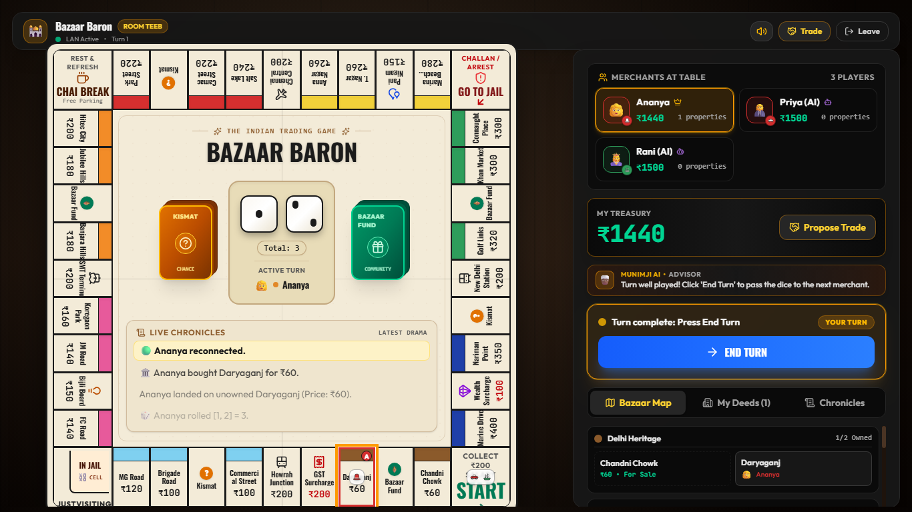

# 🎮 Bazaar Arcade — LAN Multiplayer Game Hub (Monopoly + UNO)

[](https://nodejs.org/)
[](https://react.dev/)
[](https://socket.io/)
[](https://tailwindcss.com/)
[](https://nodejs.org/api/test.html)
[]()

**Bazaar Arcade** is an offline multiplayer LAN tabletop game platform engineered for 2–10 players across local Wi-Fi. One host machine runs a unified Node.js server (`port 3000`); all friends and family connect instantly from any mobile phone, tablet, or PC browser without needing internet or app installs.

Select and play two classic tabletop games from a single lobby:
1. 🕌 **Bazaar Baron**: Monopoly-style property trading game set across iconic Indian cities.
2. 🃏 **Bazaar UNO**: Full-featured 108-card classic UNO with Skip, Reverse, +2, +4, Wild color picker, and real-time "Call UNO!" callout mechanics.

---

## 📸 Visual Showcase

<div align="center">

### Desktop Board Experience (1080p & 4K)
*Authentic quad-fold cardboard tabletop board with rotating perimeter tiles, 3D dice, and full territory overview.*


<br/>

### Mobile Portrait & Laptop Views
*Playable on any phone in portrait mode with touch-friendly 44px+ tap targets, collapsible bottom sheets, and responsive side panel.*

| 📱 Mobile Phone (390×844) | 💻 Laptop Screen (1366×768) |
| :---: | :---: |
|  |  |

</div>

---

## ⚡ 1-Click Launch (Windows)

Simply double-click the included **`start.bat`** file in the root directory:

```bat
start.bat
```

`start.bat` will automatically:
1. Verify Node.js v20+ is installed.
2. Automatically install server & client dependencies if missing (`npm install`).
3. Build the production client bundle (`npm run build`).
4. Start the server on `http://localhost:3000` and open your default browser.
5. Display your local Wi-Fi IP and a scannable QR code directly in the terminal so your friends can scan and join from their phones!

---

## 🃏 Game 1: Bazaar UNO Features

- **Official 108-Card Deck**:
  - 76 Number cards (0-9 across Red, Blue, Green, Yellow).
  - 24 Action cards (Skip, Reverse, Draw Two +2 across 4 colors).
  - 8 Wild cards (4 Multi-color Wild, 4 Wild Draw Four +4).
- **Interactive Tabletop Card Table**:
  - Draw pile with card back 3D stack and live card counts.
  - Glowing active color ring indicator (Red, Blue, Green, Yellow).
  - Direction indicator showing Clockwise (↻) or Counter-Clockwise (↺) rotation.
- **"CALL UNO!" Mechanics & Penalty Catching**:
  - Prominent pulsing **CALL UNO!** button when holding 1 or 2 cards.
  - If a player holds 1 card without calling UNO, any opponent can hit **Catch! 🚨** to inflict a 2-card penalty!
- **AI Bot Opponents**:
  - Host can invite AI friends (*Priya AI*, *Rani AI*, *Kabir AI*) with realistic ~900ms human pacing, strategic color choices, and automatic UNO calls.
- **Round Scoring**:
  - Hand points scored by the winner at round end. First to target score (250 pts) wins the championship.

---

## 🕌 Game 2: Bazaar Baron (Monopoly) Features

- **Classic Tabletop Aesthetic**:
  - Warm, rich wooden background texture with an authentic cream quad-fold cardboard board (`#F3EBD8`).
  - True tabletop orientation: Left and right perimeter tiles rotate text 90°, top row tiles rotate 180° — no clipped or overlapping text.
  - Inner color bands on all 22 properties with WCAG AAA compliant text contrast.
  - Distinct SVG pawn tokens (🎩 Top Hat, 🚗 Vintage Car, 🐕 Terrier Dog, 🚢 Steamship, 👢 Leather Boot, 🧵 Brass Thimble).
- **Authentic Indian Locality Theme**:
  - 40 perimeter tiles featuring iconic real-world localities across Delhi, Mumbai, Kolkata, Bengaluru, Pune, Hyderabad, and Chennai.
  - Original Chance & Community card decks (*Kismat* & *Bazaar Welfare Fund*) loaded with witty, culturally resonant events.
- **Munimji AI Financial Advisor**:
  - Real-time in-game advisor analyzing monopoly set completion, cash reserves, and recommended trades.
- **Non-Blocking, Glitch-Free Modals**:
  - Quick property purchase card docked directly inside the side panel.
  - Minimizable, non-blocking **Debt Insolvency** & **Auction** banners: players in debt can freely minimize notices, inspect their properties, mortgage assets, or sell houses without screen freezes.

---

## 🗺️ Indian Locality Board Mapping (Bazaar Baron)

| Color Group | Hex Code | Locality / Landmark | City | Base Cost |
| :--- | :--- | :--- | :--- | :--- |
| **Brown** | `#8B5A2B` | Chandni Chowk, Daryaganj | Old Delhi | ₹60 |
| **Sky Blue** | `#7FD0F0` | Park Street, Howrah, Salt Lake | Kolkata | ₹100 – ₹120 |
| **Pink** | `#E75A9B` | Brigade Road, Commercial Street, MG Road | Bengaluru | ₹140 – ₹160 |
| **Orange** | `#F28C28` | FC Road, JM Road, Koregaon Park | Pune | ₹180 – ₹200 |
| **Red** | `#D62F2F` | Banjara Hills, Jubilee Hills, Hitec City | Hyderabad | ₹220 – ₹240 |
| **Yellow** | `#F2D13A` | T. Nagar, Anna Nagar, Marina Beach | Chennai | ₹260 – ₹280 |
| **Green** | `#2E9D5B` | Colaba Causeway, Bandra Bandstand, Juhu Beach | Mumbai | ₹300 – ₹320 |
| **Navy Blue** | `#1F3FA8` | Connaught Place, Khan Market | New Delhi | ₹350 – ₹400 |
| **Transit** | `#1B1B1B` | NDLS Station, Howrah Junction, CST Terminus, Chennai Central | National Rail | ₹200 |
| **Utilities** | `#475569` | Urja Power Grid, Jal Board Supply | Municipal | ₹150 |

---

## 🚀 Manual Terminal Start

### Prerequisites
- [Node.js](https://nodejs.org/) v20.0.0 or higher.
- A local Wi-Fi router (no internet connection required).

### 1. Installation
```powershell
npm install
cd client
npm install
npm run build
cd ..
```

### 2. Verify with Automated Test Suite
Run the built-in Node.js test runner covering pure reducer rules, doubles/jail mechanics, bank limits, auctions, trading, AI bots, and UNO engine:
```powershell
npm test
```
*(All 46 tests across 16 suites execute and pass in ~400ms)*

### 3. Start the Server
```powershell
npm start
```

Upon launch, the server binds to `0.0.0.0:3000` and displays:
- **Local Address**: `http://localhost:3000`
- **Wi-Fi LAN Address**: `http://<YOUR_LAN_IP>:3000`
- **Terminal QR Code**: Scan directly with mobile phone cameras to open the game instantly!

---

## 📱 How to Play with Friends on Wi-Fi

1. **Host Setup**:
   - Double-click `start.bat` (or run `npm start`) on the host PC.
   - Choose your name, select an avatar, and pick your game: **🕌 Bazaar Baron** or **🃏 Bazaar UNO**.
   - Click **Create Room**. A 4-letter room code (e.g. `KISM`) is displayed.
2. **Friends Join**:
   - Connect all phones, tablets, or laptops to the **same Wi-Fi network**.
   - Point phone camera at the terminal QR code or navigate to `http://<HOST_LAN_IP>:3000`.
   - Click **Join Room**, enter your name, and enter the 4-letter room code.
   - *(Optional)*: Host can click **+ Add AI Friend (Bot)** to invite *Priya (AI)*, *Rani (AI)*, or *Kabir (AI)*.
3. **Commence Game**:
   - Host clicks **Start Game**. All connected screens transition immediately into the live game.

---

## 🛡️ Windows Firewall & LAN Troubleshooting

If mobile devices cannot connect to `http://<YOUR_LAN_IP>:3000`:

1. **Windows Defender Firewall**:
   - When running Node for the first time, allow access on **Private networks**.
   - To unblock manually: Open **Windows Defender Firewall** > **Allow an app or feature through Windows Defender Firewall** > Locate `Node.js JavaScript Runtime` > Check **Private**.
2. **Wi-Fi Network Profile (Crucial)**:
   - In Windows: Go to **Settings** > **Network & Internet** > **Wi-Fi** > Click your Wi-Fi name > Change **Network Profile Type** to **Private Network**. Windows blocks incoming port connections on "Public" profiles.
3. **Same Subnet**:
   - Ensure mobile phones are not on cellular data or guest Wi-Fi networks.

---

## 📜 License
Released under the MIT License. Built for offline multiplayer tabletop fun with friends and family.
