# 🎮 Bazaar Arcade — LAN Multiplayer Game Hub (4 Games: Monopoly + UNO + Ludo + Snakes)

[](https://nodejs.org/)
[](https://react.dev/)
[](https://socket.io/)
[](https://tailwindcss.com/)
[](https://nodejs.org/api/test.html)
[](https://www.linux.org/)
[]()
[]()

**Bazaar Arcade** is an offline multiplayer LAN tabletop game platform engineered for 2–10 players across local Wi-Fi or mobile hotspots. One host machine runs a unified Node.js server (`port 3000`); all friends and family connect instantly from any mobile phone, tablet, or PC browser without needing internet, accounts, or app store downloads.

Select and play 4 classic tabletop games from a unified interactive lobby:
1. 🕌 **Bazaar Baron**: Monopoly-style property trading game set across iconic Indian cities with authentic quad-fold cardboard aesthetic, Munimji AI advisor, and non-blocking modals.
2. 🃏 **Bazaar UNO**: Full-featured official 108-card UNO with Skip, Reverse, +2, +4, Wild color picker, 3D card table, and real-time "Call UNO!" callout mechanics.
3. 🎲 **Bazaar Ludo**: Authentic 15×15 cross-and-circle token race with safe star sanctuaries, track captures, bonus rolls, home stretch isolation, and tactical AI bots.
4. 🐍 **Snakes & Ladders**: 100-tile climb-and-slide race with soaring emerald ladders, venomous snakes, extra roll on 6, and exact tile-100 victory rules.

---

## ⚡ 1-Command Instant Launch

Clone the repository and launch the entire arcade in one single command:

### 🐧 Linux & macOS (1-Command Terminal)
```bash
git clone https://github.com/ArushSengar/Bazaar-Baron.git && cd Bazaar-Baron && chmod +x start.sh && ./start.sh
```

### 🪟 Windows (1-Command PowerShell)
```powershell
git clone https://github.com/ArushSengar/Bazaar-Baron.git; cd Bazaar-Baron; .\start.bat
```
*(Or simply double-click `start.bat` in Windows File Explorer)*

> **What `start.sh` and `start.bat` do automatically:**
> 1. Verify Node.js v20+ is present on your system.
> 2. Auto-install server and client dependencies (`npm install`).
> 3. Build the high-performance client production bundle (`npm run build`).
> 4. Launch the game server on `http://localhost:3000` and automatically pop open your browser.
> 5. Print your local Wi-Fi IP and a **scannable terminal QR code** so friends on phones can join in seconds!

---

## 📸 Visual Showcase & Screen Gallery

<div align="center">

### 🕹️ Arcade Game Hub & Unified Lobby
*Choose between Bazaar Baron (Monopoly), Bazaar UNO, Bazaar Ludo, and Snakes & Ladders, configure anti-stalemate match timers (10m–30m), or invite AI Bot merchants.*

| 🖥️ Desktop Lobby (1920×1080) | 📱 Mobile Phone Lobby (390×844) |
| :---: | :---: |
| 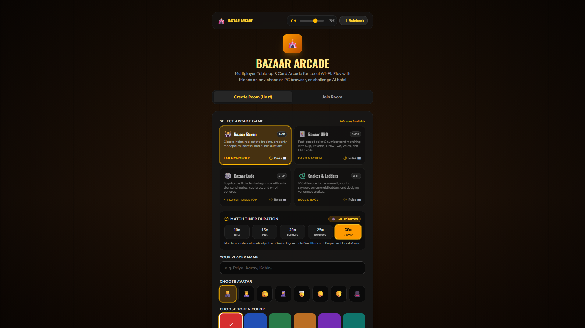 | 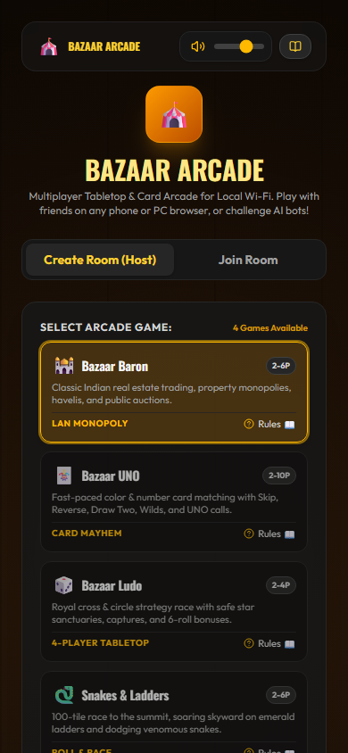 |

<br/>

### 🕌 Bazaar Baron (Monopoly) — 3D Isometric & Tabletop Board
*Authentic multi-layer cardboard bevel edges, 3D volumetric havelis & grand palace hotels, brass pedestals, and dynamic 3D tabletop perspective toggle.*

| 🎲 3D Isometric Tabletop View | 🗺️ Classic 2D Tabletop Board |
| :---: | :---: |
| 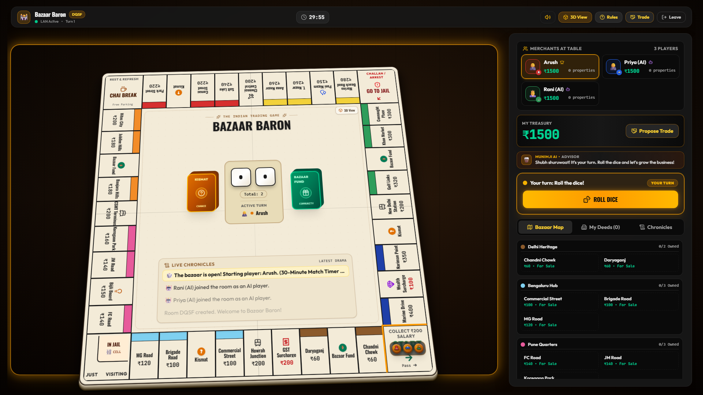 | 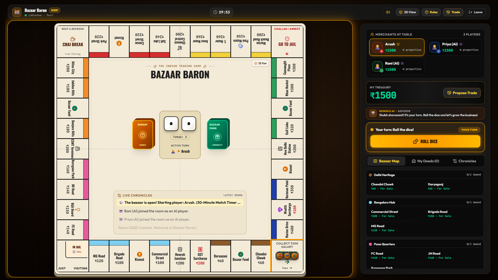 |

| 📱 Mobile Phone Board View | 📜 3D Title Deed & Mortgage Modal |
| :---: | :---: |
| 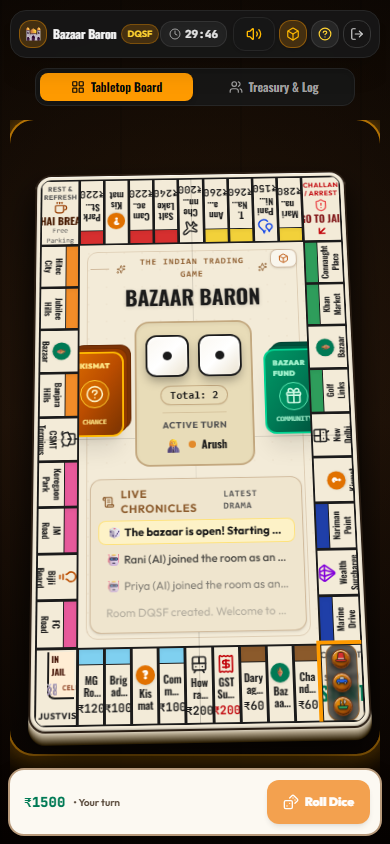 | 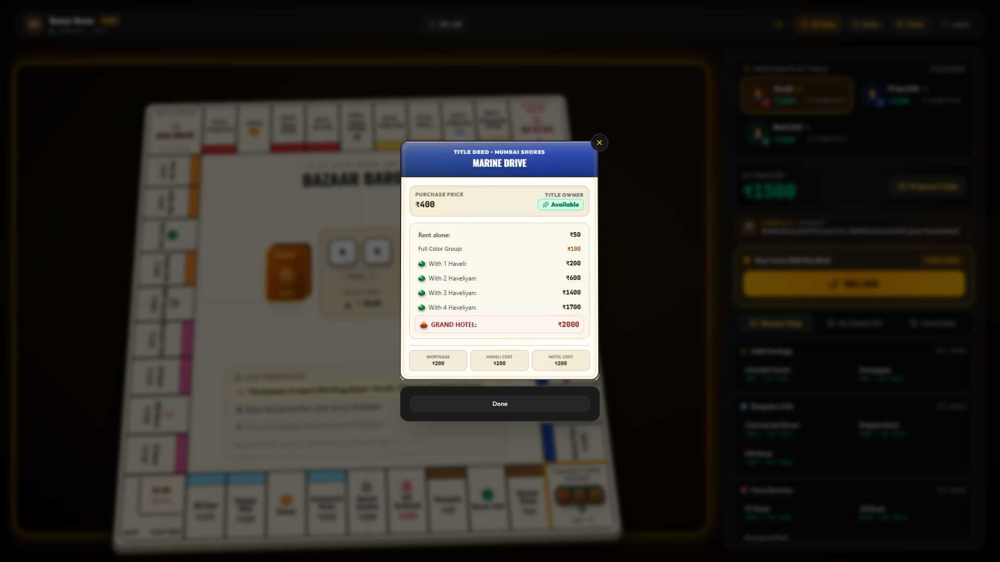 |

<br/>

### 🃏 Bazaar UNO Tabletop Experience
*Official 108-card deck, active color glow indicator, 3D draw pile stack, card counters, and pulsing "CALL UNO!" button.*

| 🖥️ Desktop Card Table | 📱 Mobile Card Table |
| :---: | :---: |
| 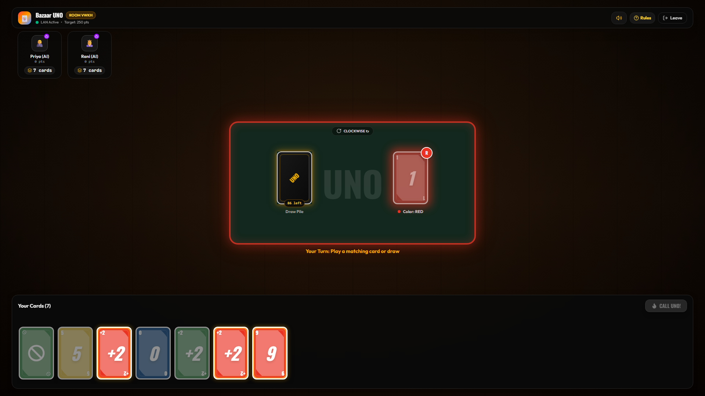 | 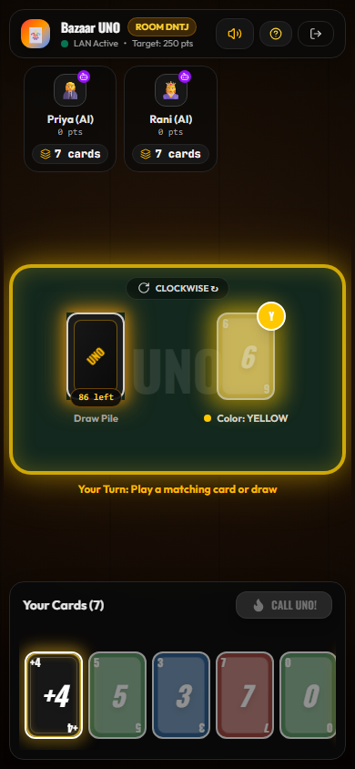 |

<br/>

### 🎲 Bazaar Ludo (Full-Screen Immersion)
*Fluid viewport-bounded responsive board scaling (88–90vh), eliminate letterboxing, safe star sanctuaries, home stretches, and dynamic token markers.*

| 🖥️ Desktop Ludo Board | 📱 Mobile Ludo Board |
| :---: | :---: |
| 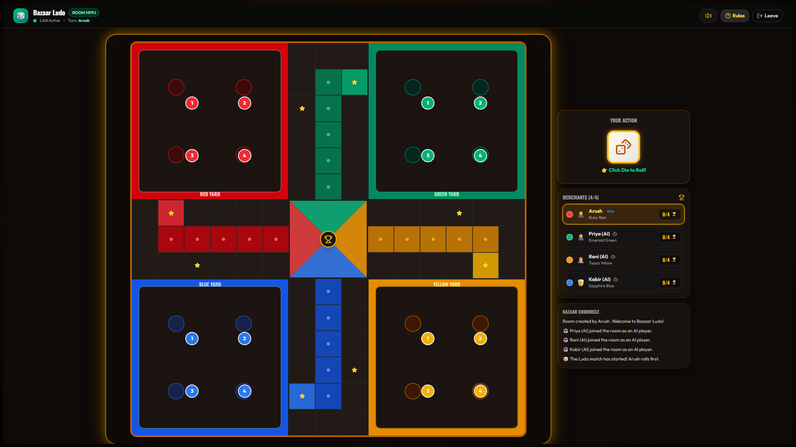 | 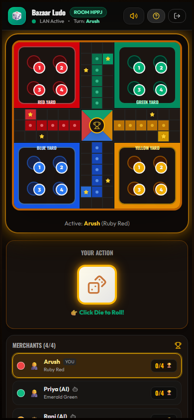 |

<br/>

### 🐍 Snakes & Ladders (Shamsheri Full-Screen Immersion)
*100-tile climb-and-slide race with soaring emerald ladders, venomous snakes, yard staging bench, and exact tile-100 victory rules.*

| 🖥️ Desktop Board | 📱 Mobile Board |
| :---: | :---: |
| 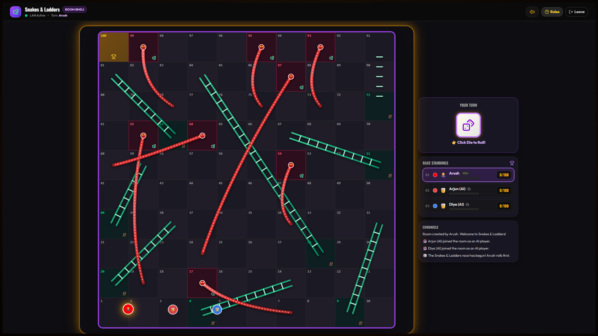 | 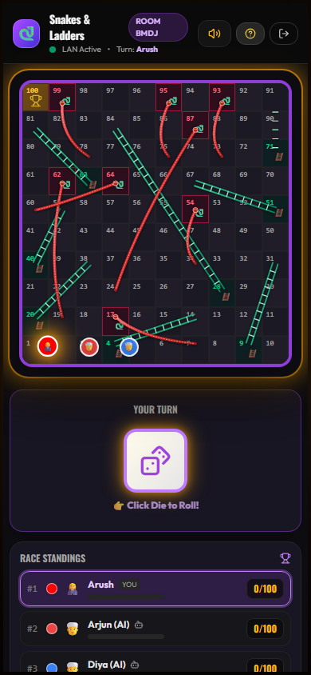 |

<br/>

### 📖 Interactive Rules & Beginner Guide
*In-game rules modal with keyboard shortcut (`?`) and dedicated game tabs.*

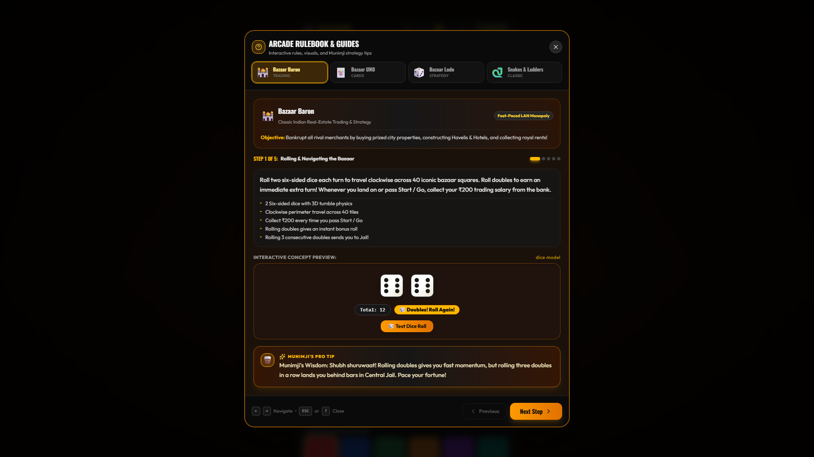

</div>

---

## 🐧 Complete Linux Installation Guide

Bazaar Arcade runs natively on all major Linux distributions. Follow the instructions for your distribution below:

### 1. Ubuntu, Debian, Linux Mint, Pop!_OS
```bash
# 1. Install Node.js 20 LTS & Git (if not already installed)
sudo apt update
sudo apt install -y curl git
curl -fsSL https://deb.nodesource.com/setup_20.x | sudo -E bash -
sudo apt install -y nodejs

# 2. Clone repository
git clone https://github.com/ArushSengar/Bazaar-Baron.git
cd Bazaar-Baron

# 3. Make launcher executable and start
chmod +x start.sh
./start.sh
```

### 2. Arch Linux, Manjaro, EndeavourOS
```bash
# 1. Install Node.js, NPM, and Git
sudo pacman -S nodejs npm git

# 2. Clone repository and start
git clone https://github.com/ArushSengar/Bazaar-Baron.git
cd Bazaar-Baron
chmod +x start.sh
./start.sh
```

### 3. Fedora, RHEL, Rocky Linux, CentOS Stream
```bash
# 1. Install Node.js and Git
sudo dnf install -y nodejs npm git

# 2. Clone repository and start
git clone https://github.com/ArushSengar/Bazaar-Baron.git
cd Bazaar-Baron
chmod +x start.sh
./start.sh
```

### 4. openSUSE (Tumbleweed / Leap)
```bash
# 1. Install Node.js and Git
sudo zypper install -y nodejs npm git

# 2. Clone repository and start
git clone https://github.com/ArushSengar/Bazaar-Baron.git
cd Bazaar-Baron
chmod +x start.sh
./start.sh
```

### 5. macOS (Homebrew)
```bash
# 1. Install Node.js and Git via Homebrew
brew install node git

# 2. Clone repository and start
git clone https://github.com/ArushSengar/Bazaar-Baron.git
cd Bazaar-Baron
chmod +x start.sh
./start.sh
```

---

## 📱 How to Play with Friends on Wi-Fi (No Internet Needed)

1. **Host Setup**:
   - Run `./start.sh` (Linux/macOS) or `start.bat` (Windows).
   - Open your browser to `http://localhost:3000`.
   - Enter your name, pick an avatar, select your game (**🕌 Bazaar Baron** or **🃏 Bazaar UNO**), and click **Create Room**.
   - A 4-letter room code (e.g. `KISM` or `UNO1`) is displayed.

2. **Friends Join**:
   - Connect all phones, tablets, or laptops to the **same Wi-Fi network** (or phone mobile hotspot).
   - Point any mobile phone camera at the **terminal QR code**, or type `http://<HOST_IP>:3000` into any mobile browser.
   - Enter player name and the 4-letter room code.
   - *(Optional)*: Click **+ Add AI Friend** in lobby to invite *Priya (AI)*, *Rani (AI)*, or *Kabir (AI)*.

3. **Start Playing**:
   - Host clicks **Start Game**. All connected devices transition simultaneously into the live game table!

---

## 🃏 Game 1: Bazaar UNO Features

- **Official 108-Card Deck**:
  - 76 Number cards (0–9 across Red, Blue, Green, Yellow).
  - 24 Action cards (Skip, Reverse, Draw Two +2 across 4 colors).
  - 8 Wild cards (4 Multi-color Wild, 4 Wild Draw Four +4).
- **Interactive Tabletop Card Table**:
  - Draw pile with 3D card stack and real-time remaining card counts.
  - Glowing active color ring indicator (Red, Blue, Green, Yellow).
  - Turn direction indicator showing Clockwise (↻) or Counter-Clockwise (↺) rotation.
- **"CALL UNO!" Mechanics & Penalty Catching**:
  - Prominent pulsing **CALL UNO!** button when holding 1 or 2 cards.
  - If a player holds 1 card without calling UNO, any opponent can hit **Catch! 🚨** to inflict a 2-card penalty!
- **AI Bot Opponents**:
  - Host can invite AI friends (*Priya AI*, *Rani AI*, *Kabir AI*) with realistic ~900ms human pacing, strategic color choices, and automated UNO calls.
- **Round Scoring**:
  - Hand points scored by the winner at round end. First to reach 250 points wins the championship.

---

## 🕌 Game 2: Bazaar Baron (Monopoly) Features

- **Classic Tabletop Aesthetic**:
  - Warm, rich wooden background texture with an authentic cream quad-fold cardboard board (`#F3EBD8`).
  - True tabletop orientation: Left and right perimeter tiles rotate text 90°, top row tiles rotate 180° — zero clipped or overlapping text.
  - Inner color bands on all 22 properties with WCAG AAA compliant text contrast.
  - Distinct SVG pawn tokens (🎩 Top Hat, 🚗 Vintage Car, 🐕 Terrier Dog, 🚢 Steamship, 👢 Leather Boot, 🧵 Brass Thimble).
- **Authentic Indian Locality Theme**:
  - 40 perimeter tiles featuring iconic real-world localities across Delhi, Mumbai, Kolkata, Bengaluru, Pune, Hyderabad, and Chennai.
  - Original Chance & Community card decks (*Kismat* & *Bazaar Welfare Fund*) loaded with witty, culturally resonant events.
- **30-Minute Match Timer & Wealth Victory (Anti-Stalemate)**:
  - Live header countdown timer (`⏱️ MM:SS`) with visual amber warnings (< 5 min) and pulsing red alerts (< 1 min).
  - Eliminates infinite property gridlocks: when the 30-minute timer expires, the match concludes automatically.
  - Winner is crowned by **Total Wealth (Net Worth)**: Treasury Cash + Unmortgaged Property Values + Mortgaged Property Values + Haveli/Hotel Construction Costs.
  - Transparent post-game Winner Modal with itemized wealth breakdown (Cash, Properties, Buildings) for every player.
- **Munimji AI Financial Advisor**:
  - Real-time in-game advisor analyzing monopoly set completion, cash reserves, and recommended trades.
- **Non-Blocking, Glitch-Free Modals**:
  - Quick property purchase card docked directly inside the side panel.
  - Minimizable, non-blocking **Debt Insolvency** & **Auction** banners: players in debt can freely minimize notices, inspect their properties, mortgage assets, or sell houses without screen freezes.

### 🗺️ Indian Locality Board Mapping

| Color Group | Hex Code | Locality / Landmark | City | Base Cost |
| :--- | :--- | :--- | :--- | :--- |
| **Brown** | `#8B5A2B` | Chandni Chowk, Daryaganj | Old Delhi | ₹60 |
| **Sky Blue** | `#7FD0F0` | Park Street, Howrah, Salt Lake | Kolkata | ₹100 – ₹120 |
| **Pink** | `#E75A9B` | Brigade Road, Commercial Street, MG Road | Bengaluru | ₹140 – ₹160 |
| **Orange** | `#F28C28` | FC Road, JM Road, Koregaon Park | Pune | ₹180 – ₹200 |
| **Red** | `#D62F2F` | Banjara Hills, Jubilee Hills, Hitec City | Hyderabad | ₹220 – ₹240 |
| **Yellow** | `#F2D13A` | T. Nagar, Anna Nagar, Marina Beach | Chennai | ₹260 – ₹280 |
| **Green** | `#2E9D5B` | Colaba Causeway, Bandra Bandstand, Juhu Beach | Mumbai | ₹300 – ₹320 |
| **Navy Blue** | `#1F3FA8` | Connaught Place, Khan Market | New Delhi | ₹350 – ₹400 |
| **Transit** | `#1B1B1B` | NDLS Station, Howrah Junction, CST Terminus, Chennai Central | National Rail | ₹200 |
| **Utilities** | `#475569` | Urja Power Grid, Jal Board Supply | Municipal | ₹150 |

---

## 🎲 Game 3: Bazaar Ludo Features

- **Authentic 15×15 Cross-and-Circle Board**:
  - Four classic colored bases (Red, Green, Yellow, Blue) with 4 tokens each.
  - 52-tile outer track with color-coded starting cells and colored home columns.
- **Safe Star Sanctuaries**:
  - Designated star sanctuary tiles grant complete capture immunity. Multiple tokens from different players can safely coexist.
- **Capture & Bonus Roll Mechanics**:
  - Landing on an opponent token on any non-safe track tile captures the token, sends it back to base, and awards an instant bonus roll.
  - Rolling a 6 allows releasing a token from base and grants an additional roll (up to 2 bonus rolls; three consecutive 6s forfeits the turn).
- **Home Stretch Isolation & Exact Arrival**:
  - Tokens enter their player-colored home column where opponent tokens cannot follow.
  - Exact dice roll required to land on the center Goal triangle. First player to guide all 4 tokens home wins!
- **AI Bot Tactical Heuristics**:
  - Intelligent bot decisions prioritizing base exit on 6, opponent captures, goal arrivals, and advancing furthest tokens with realistic pacing.

---

## 🐍 Game 4: Snakes & Ladders Features

- **100-Tile Tabletop Race**:
  - Serpentine numbered grid (1 to 100) with animated pawn movements and glowing active-turn highlights.
  - Visual SVG emerald ladders and venomous serpents connecting origin and destination tiles.
- **Authentic Tabletop Rules**:
  - Landing on a ladder foot automatically climbs to the ladder top.
  - Landing on a snake head triggers an animated slide down to the snake tail.
  - Rolling a 6 awards an extra roll (three consecutive 6s forfeits the third roll).
  - Exact tile-100 win condition: overshooting tile 100 holds the pawn in place ("stay" rule).
- **Automated AI Bots & Procedural Audio**:
  - Supports 2–6 players or AI bots with ladder chime sound cues and snake hiss audio effects.

---

## 🔊 Procedural Web Audio, Glowing Visual FX & Beginner Guides

- **Procedural Web Audio Synthesizer (`utils/audio.js`)**:
  - 100% synthesized sound effects generated entirely with the browser's native `AudioContext` — zero external MP3s or network requests!
  - Sound effects for dice rolls, token hops, card plays, reverse direction swooshes, ladder ascents, snake hiss slides, error buzzes, and victory fanfares.
  - Global `AudioControls.jsx` widget with volume slider (0–100%) and one-click mute toggle.
- **Glowing Visual FX & Responsive Design**:
  - Glowing ambient turn rings and pulsating indicators for active players.
  - Card flight animations, 3D dice rolling, and celebration confetti canvas (`ConfettiCanvas.jsx`) on match victory.
- **Interactive Beginner Guides (`HowToPlayModal.jsx`)**:
  - Press the **'?'** key anytime or click the rule guide button in the lobby or side panel to open a step-by-step visual tutorial for any game.

---

## 🛡️ Firewall & LAN Troubleshooting (Linux & Windows)

If mobile devices on your Wi-Fi cannot connect to `http://<YOUR_LAN_IP>:3000`:

### 🐧 Linux (UFW / firewalld / iptables)
Allow inbound connections to port 3000 on your local network:
```bash
# Ubuntu / Debian / Linux Mint (UFW)
sudo ufw allow 3000/tcp

# Fedora / RHEL / CentOS (firewalld)
sudo firewall-cmd --add-port=3000/tcp --permanent
sudo firewall-cmd --reload

# Arch / Generic Linux (iptables)
sudo iptables -A INPUT -p tcp --dport 3000 -j ACCEPT
```

### 🪟 Windows Defender Firewall
1. **Network Profile Type (Most Common Issue)**: Open **Windows Settings** > **Network & Internet** > **Wi-Fi** > Click your connected network > Set **Network Profile Type** to **Private Network**. Windows automatically blocks incoming LAN port connections on "Public" networks.
2. **Allow Node through Firewall**: Open **Windows Defender Firewall** > **Allow an app through firewall** > Find `Node.js JavaScript Runtime` > Check both **Private** and **Public**.
3. **Same Subnet / Router**: Ensure phones are on the same Wi-Fi router (not mobile cellular data or router "Guest" isolation network).

---

## 🧪 Automated Test Suite (261 Tests Passing)

Bazaar Arcade includes an exhaustive pure unit, engine, integration, and opaque-box E2E test suite using Node.js's native test runner (`node --test`). Tests verify rent calculations, doubles/jail mechanics, bank supply limits, auctions, trading, UNO 108-card deck rules, Ludo token captures, Snakes & Ladders climbs/slides, audio clamping, adversarial edge cases, and headless 200-turn random simulations:

```bash
# Run 77 Engine & Registry Unit Tests
npm test

# Run 184 Opaque-Box E2E & Adversarial Hardening Tests across 5 Tiers
node --test server/test/e2e/runner.test.js
```

```
✔ AI Bot Integration: Host can add bots with diverse avatars in lobby
✔ AI Bot Turn Execution: Pure reducer handles bot actions identically to human actions
✔ AI Bot Auction & Jail Behavior: Bot bids proportionally and pays jail fines
✔ Bazaar Baron Pure Engine Tests (Rent, Doubles, Jail, Even Building, Mortgages, Bankruptcy)
✔ Game Registry: Dynamic routing across all 4 games and player capacities
✔ Bazaar Ludo Pure Engine Tests (Safe stars, captures, bonus rolls, home stretch isolation, AI bot)
✔ Snakes & Ladders Pure Engine Tests (Ladders, snakes, extra roll on 6, exact 100 win condition)
✔ UNO Deck & Rules: Standard 108 cards, canPlay validation, Skip, Reverse, Draw 2, Wilds, Call UNO
✔ Headless Simulation: 200 random turns with 4 simulated players adheres to all invariant rules
✔ 30-Minute Match Timer & Wealth Victory Suite (5 / 5 tests pass)
✔ E2E Tier 1 (Feature Coverage): 55 / 55 tests pass
✔ E2E Tier 2 (Boundary & Corner Cases): 55 / 55 tests pass
✔ E2E Tier 3 (Pairwise Cross-Feature Combinations): 11 / 11 tests pass
✔ E2E Tier 4 (Comprehensive Application Scenarios): 6 / 6 full match playflows pass
✔ E2E Tier 5 (Adversarial Coverage Hardening): 57 / 57 adversarial stress tests pass

ℹ tests 266
ℹ suites 53
ℹ pass 266
ℹ fail 0
```

---

## 🏗️ Repository Architecture

```
Bazaar-Baron/
├── client/                     # Vite + React 19 Frontend
│   ├── src/
│   │   ├── components/         # UI Components (Lobby, Board, UnoScreen, UnoCard, Modals)
│   │   ├── data/               # Constants, tiles, unoRules, guides
│   │   ├── hooks/              # Custom hooks (useSocket, useSoundFx)
│   │   ├── utils/              # Sound synthesis & Web Audio helpers
│   │   └── index.css           # Tailwind v4 styles, custom animations & glows
│   └── package.json
├── server/                     # Unified Node.js Socket.IO Server
│   ├── engine/                 # Pure Functional Reducer Game Engines
│   │   ├── monopoly/           # Bazaar Baron engine (state, reducer, rules, bot, munimji)
│   │   ├── uno/                # Bazaar UNO engine (deck, rules, reducer, bot)
│   │   ├── ludo/               # Bazaar Ludo engine (state, rules, reducer, bot)
│   │   └── snakes/             # Snakes & Ladders engine (state, rules, reducer, bot)
│   ├── test/                   # Comprehensive Node.js native test runner suites
│   └── index.js                # HTTP server, Socket.IO router & QR code generator
├── docs/
│   └── images/                 # Screenshot gallery (Lobby, UNO, Desktop, Mobile, Laptop)
├── start.sh                    # 1-Command cross-platform launcher for Linux & macOS
├── start.bat                   # 1-Click launcher for Windows
└── package.json
```

---

## 📜 License
Released under the [MIT License](LICENSE). Built with ❤️ for offline tabletop gaming nights with friends and family.
